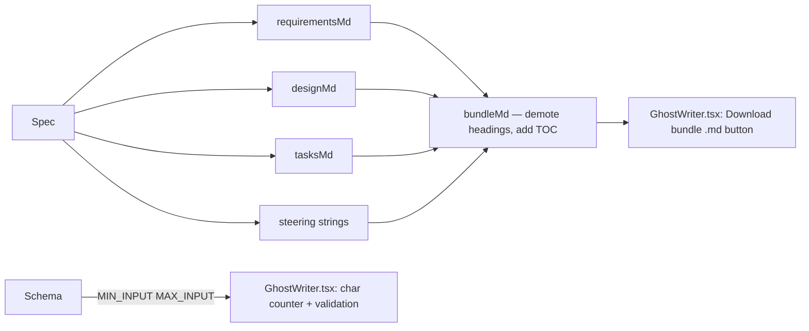

# Design Document: Spec Bundle Export

## Overview

Two small, self-contained additions to GhostWriter: a pure function in `lib/bundle.ts` that stitches the existing per-document renderers into a single markdown file with a table of contents, and client-side UI changes in `GhostWriter.tsx` that add a live character counter, validation messages, and a "Download bundle (.md)" button. No server changes, no new dependencies.

## Architecture

## Components and Interfaces

- `lib/schema.ts` — add `MIN_INPUT = 20` export alongside existing `MAX_INPUT = 8000`; use it in `InputSchema`.
- `lib/bundle.ts` — new file. `bundleMd(spec: Spec): string` imports `requirementsMd`, `designMd`, `tasksMd` from `lib/markdown.ts`, demotes each document's headings by one level so the bundle has a single H1, prepends a table of contents, and appends steering text. Pure function, no React imports.
- `app/components/GhostWriter.tsx` — import `MIN_INPUT`, `MAX_INPUT` from `@/lib/schema` and `bundleMd` from `@/lib/bundle`; add a character counter below the textarea, validation messages for too-short/too-long input, and a "Download bundle (.md)" button next to the existing zip download.
- `app/globals.css` — small `.counter`, `.warn` styles for the new UI elements.

## Data Models

Uses the existing `Spec` type from `lib/schema.ts`. No new types.

## Error Handling

All validation is client-side. The character counter and messages are purely informational; the Resurrect button remains disabled when input is too short. No API or server changes.

## Testing Strategy

Vitest unit tests in `tests/bundle.test.ts` verifying:
- The bundle contains exactly one H1 heading.
- The bundle contains a table of contents.
- All four sections (requirements, design, tasks, steering) are present.
- Headings from the source documents are demoted by one level.
- The function is pure (same input → same output).
