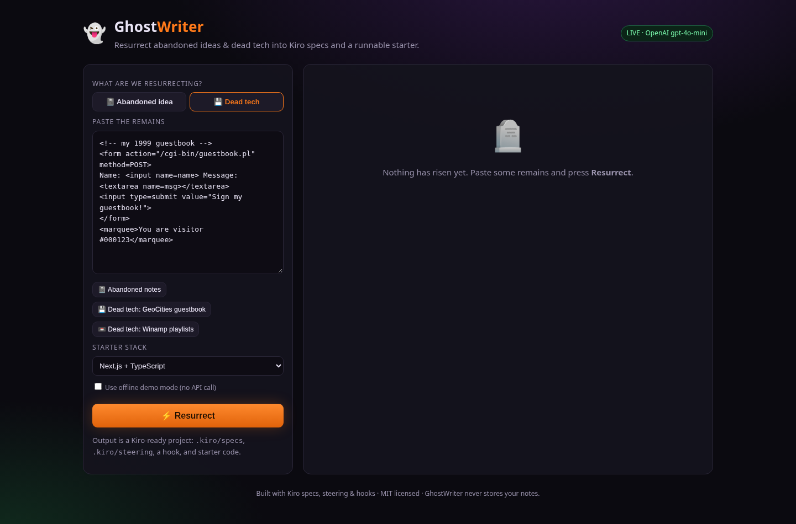
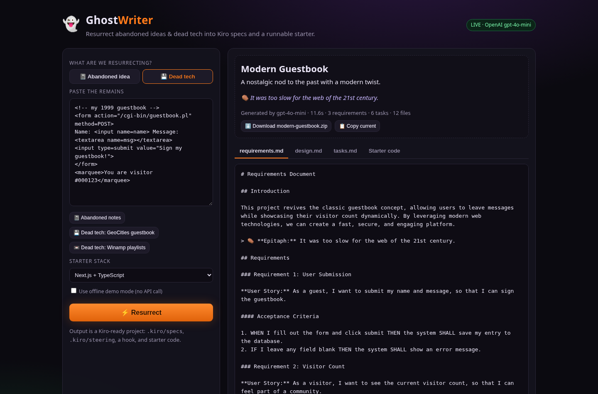
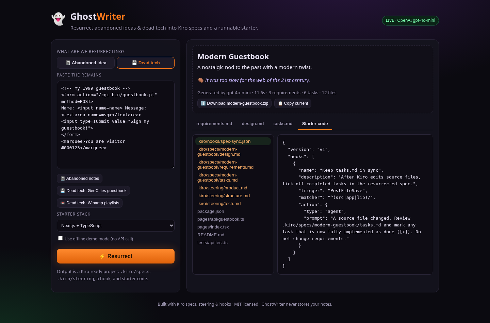
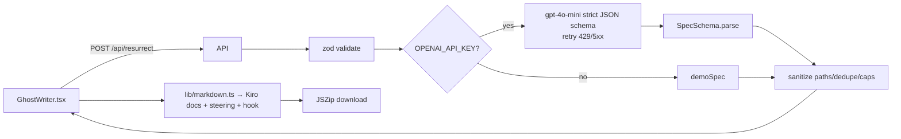

# 👻 GhostWriter — resurrect dead ideas into Kiro specs

**Live:** https://ghostwriter-suganthikannan093.vercel.app · **Demo video (85 s):** [docs/demo.mp4](docs/demo.mp4)

Paste an abandoned idea, half-written notes, or a snippet of dead technology (a 1999 CGI guestbook, Winamp playlists, Flash…). GhostWriter brings it back as a **Kiro-ready project**:

- `requirements.md` with user stories and **EARS** acceptance criteria (`WHEN … THEN … SHALL`)
- `design.md` (overview, architecture with a mermaid diagram, components, data model, errors, testing)
- `tasks.md` — checkbox implementation plan linked to requirement ids
- `.kiro/steering/{product,tech,structure}.md` and a `.kiro/hooks/spec-sync.json` hook
- a small **runnable starter** (Next.js, Node CLI or FastAPI) with a test
- one-click **zip download** — open the folder in Kiro and start running tasks

Kiroween 2026 · **Resurrection** category · MIT licensed.





## Run it

```bash
npm install
cp .env.example .env.local     # optional: add OPENAI_API_KEY
npm run dev                    # http://localhost:3300
```

No key? GhostWriter runs in **DEMO MODE** (badge in the header): a deterministic offline resurrection so judges can try every screen. With a key, there is also a "Use offline demo mode" checkbox.

| Command | What |
| --- | --- |
| `npm test` | Vitest (sanitiser, renderers, demo flow, property-style path test) |
| `npm run lint` / `npm run typecheck` | ESLint / `tsc --noEmit` |
| `npm run build && npm start` | production on port 3300 |

Env: `OPENAI_API_KEY` (optional), `OPENAI_MODEL` (default `gpt-4o-mini`), `GHOSTWRITER_MODE=demo` (force demo). Live AI calls are rate-limited per visitor (`lib/ratelimit.ts`: 8 per 10 min, 4 concurrent; tune with `GHOSTWRITER_RATE_LIMIT`, `GHOSTWRITER_RATE_WINDOW_MS`, `GHOSTWRITER_MAX_CONCURRENT`); demo mode is not limited.

## Architecture



- `app/components/GhostWriter.tsx` — input, samples, tombstone header, tabs, file tree, zip
- `app/api/resurrect/route.ts` — `GET` mode, `POST` resurrect (400/401/422/502/503 errors)
- `lib/schema.ts` zod + strict JSON schema · `lib/prompt.ts` · `lib/llm.ts` · `lib/safe.ts` · `lib/markdown.ts` · `lib/demo.ts`
- One model call per resurrection (~10–15 s, a fraction of a cent on gpt-4o-mini). Notes are not stored. Model-written paths are sanitised (no `..`, no absolute paths, no `.kiro/` overrides).

## How Kiro is used

The repo's own [`/.kiro`](.kiro) directory (committed, not gitignored):

| Kiro feature | File(s) | Purpose |
| --- | --- | --- |
| **Spec** | `.kiro/specs/ghostwriter/{requirements,design,tasks}.md` | GhostWriter's own spec: 4 requirements in EARS, design with mermaid, 7 tasks mapped to requirement ids |
| **Steering** | `.kiro/steering/product.md`, `tech.md` (`inclusion: always`), `structure.md` (`inclusion: fileMatch`) | Product tone, token budget + retry rules, "change SpecSchema/specJsonSchema/demoSpec together" |
| **Hooks** (v1 JSON, `PostFileSave`) | `test-on-save.json`, `lint-on-save.json`, `update-readme.json`, `schema-guard.json` | Run Vitest / ESLint on save; agent prompts keep README + tasks.md in sync and stop schema drift |
| **Custom agent** | `.kiro/agents/ghostwriter-reviewer.json` | Read-only reviewer that checks EARS wording, task↔requirement links and secret-free starters |
| **MCP** | `.kiro/settings/mcp.json` | `fetch` server so Kiro can read Kiro docs / format references while editing |
| **Property-style test** | `tests/core.test.ts` | "Sanitised paths never contain `..`" across 200 generated paths |

And the product itself **outputs Kiro**: every resurrected zip contains `.kiro/specs/<slug>/`, `.kiro/steering/`, and a `spec-sync` hook, so the revived project is opened in Kiro and implemented task by task.

> Hook format follows the current Kiro docs (`.kiro/hooks/*.json`, `"version": "v1"`, PascalCase triggers — IDE 1.0 / CLI V3). Older `.kiro.hook` files are the IDE 0.x format.

## License

MIT — see [LICENSE](LICENSE).
